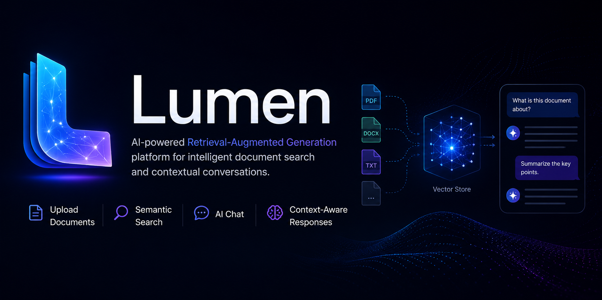
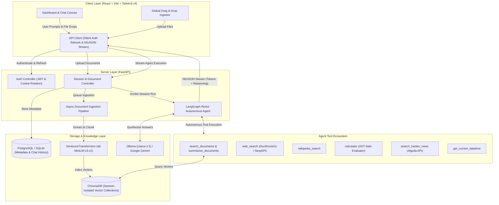

<div align="center">

# Lumen AI — Autonomous RAG Agent & Multi-Source Knowledge Workspace

[](https://www.mlh.com/events/hacktoberfest-hack-day-noida-delhi-ncr-x-niat-niu)
[](https://www.mlh.com/events/hacktoberfest-hack-day-noida-delhi-ncr-x-niat-niu)
[](https://hacktoberfest.com/)
[](LICENSE)

**An intelligent, multi-tool RAG workspace featuring LangGraph ReAct autonomous reasoning, live web cross-verification, real-time NDJSON streaming, and a modern, professional interface.**

[Event Page](https://www.mlh.com/events/hacktoberfest-hack-day-noida-delhi-ncr-x-niat-niu) • [Architecture](#-system-architecture) • [Features](#-key-features) • [Quickstart](#-quickstart-guide) • [API Reference](#-api-endpoints)

---

</div>

## 🏆 Hackathon Submission Details

This project is created and submitted for **[Hacktoberfest Hack Day Noida (Delhi NCR) x NIAT-NIU](https://www.mlh.com/events/hacktoberfest-hack-day-noida-delhi-ncr-x-niat-niu)**, hosted in collaboration with **Major League Hacking (MLH)** and **Noida International University (NIAT-NIU)**.

* **Track / Theme**: Open Source AI Tools, Developer Productivity, and Intelligent Retrieval
* **Problem Addressed**: Traditional RAG systems often produce closed-world hallucinations or provide stale local answers without external fact-checking. Users rarely get visibility into the AI's decision chain.
* **Our Solution**: **Lumen AI** breaks these limitations by pairing session-isolated document ingestion with an autonomous **LangGraph ReAct agent**. The agent dynamically determines when to retrieve local chunks, when to cross-reference claims on the live web, how to parse mathematical calculations with a secure AST sandbox, and how to query community discussions—all streamed in real-time with transparent reasoning logs and clickable inline citations.

---

## 💡 What is Lumen AI?

**Lumen AI** is an enterprise-grade, self-hosted Retrieval-Augmented Generation (RAG) assistant designed for researchers, developers, and knowledge workers. 

Instead of a generic prompt-and-response box, Lumen provides a rich, multi-session research environment:
1. **Upload Multi-Format Knowledge**: Drop in PDFs, Word docs, Markdown files, CSVs, or text notes.
2. **Autonomous Tool Selection**: The LangGraph agent reasons through user queries, calling local ChromaDB vector search, DuckDuckGo web search, Wikipedia, or a sandboxed Python calculator.
3. **Live Verifiable Answers**: Every answer provides real-time tool trace accordions and structured citation chips referencing exact document pages and web sources.
4. **Professional Light Theme**: Engineered with an accessible, high-contrast, modern UI built on Tailwind CSS v4 and React.

---

## 🏗️ System Architecture



---

## ✨ Key Features

### 🧠 1. LangGraph ReAct Autonomous Reasoning
* **Dynamic Multi-Tool Execution**: The agent autonomously decides which tools to invoke depending on the nature of the prompt.
* **Local-First with External Fact-Checking**: Automatically combines facts from uploaded documents with real-time web searches to confirm currency and verify statements.
* **Transparent Thinking Logs**: Expandable reasoning accordions expose the agent's exact decision tree, tool inputs, and progress while it runs.
* **Inline Citation Engine**: Synthesizes verified references (`@@CITE_DOC@@`, `@@CITE_WEB@@`, `@@CITE_HACKERNEWS@@`) into clean, interactive citation pills.

### 📚 2. Multi-Format Document Ingestion
* **Supported Formats**: `.pdf`, `.docx`, `.txt`, `.md`, `.csv` with MIME-type and extension validation.
* **Session-Isolated Knowledge**: Each research session maintains an isolated ChromaDB collection, preventing knowledge bleed across different projects.
* **Background Chunking**: Documents are processed asynchronously via `RecursiveCharacterTextSplitter` and embedded using `sentence-transformers/all-MiniLM-L6-v2`.
* **Automatic Error Recovery**: Corrupted or unprocessable uploads trigger transaction rollbacks and user alerts.

### 🎨 3. Modern, Accessible Light Theme
* **Human-Centered Visual Design**: Refined warm-gray background (`#f8f9fb`), pristine white surfaces, and an indigo accent palette (`indigo-600`).
* **Rich Markdown Rendering**: Full support for tables, blockquotes, syntax-highlighted code blocks, copy-to-clipboard utilities, and numbered lists.
* **Seamless File Drops**: Drag-and-drop overlay allows instant document upload from any section of the workspace.

### 🔒 4. Enterprise-Grade Authentication & Reliability
* **Dual-Token JWT Security**: Uses HTTP-only cookie-based access and refresh tokens.
* **Silent Token Rotation**: Built-in client interceptors automatically renew credentials on token expiry without disrupting streaming conversations or user interactions.
* **Rate Limiting**: Integrated `slowapi` rate-limiting guards endpoints against abuse.

---

## 🛠️ Tech Stack

| Domain | Technology | Purpose |
|---|---|---|
| **Frontend Framework** | React 19 + Vite | High-performance SPA with fast HMR |
| **Styling** | Tailwind CSS v4 + Material Symbols | Light-mode design system and typography |
| **Backend API** | FastAPI (Python 3.12) | Asynchronous REST and streaming server |
| **Agent Orchestration** | LangGraph + LangChain Core | ReAct state graphs and multi-tool routing |
| **Vector Storage** | ChromaDB | Persistent local vector embeddings |
| **Embeddings** | SentenceTransformers (`all-MiniLM-L6-v2`) | Local, private semantic document chunk embeddings |
| **LLM Inference** | Ollama (`llama3.2`) / Google Gemini | Local offline inference or cloud reasoning |
| **Database** | SQLite / Supabase PostgreSQL | Session management, chat history, and user credentials |
| **Tools & Search** | DuckDuckGo, SerpAPI, Wikipedia, Algolia HN | Web ground truth and external knowledge retrieval |

---

## 🚀 Quickstart Guide

Follow these steps to run Lumen AI locally for judging and evaluation.

### 1. Prerequisites
* **Python**: 3.11 or 3.12
* **Node.js**: v18+ and `npm`
* **Ollama**: [Download & install Ollama](https://ollama.com/) (or configure Google Gemini API key)

```bash
# Pull the default local LLM model
ollama pull llama3.2
```

---

### 2. Backend Setup

```bash
cd backend

# Option A: Using uv (Recommended)
uv venv
source .venv/bin/activate  # On Windows: .venv\Scripts\activate
uv pip install -r requirements.txt

# Option B: Standard Python venv
python3 -m venv .venv
source .venv/bin/activate  # On Windows: .venv\Scripts\activate
pip install -r requirements.txt
```

Create a `.env` file in `backend/`:
```env
ACCESS_TOKEN_SECRET="hacktoberfest-lumen-secret-key-32-chars-min"
REFRESH_TOKEN_SECRET="hacktoberfest-lumen-refresh-secret-key-32"
is_development=True
DB_URL="sqlite+aiosqlite:///./db.sqlite3"
OLLAMA_MODEL="llama3.2"
OLLAMA_BASE_URL="http://localhost:11434"
```

Start the backend API server:
```bash
python main.py
```
> The API server will start on **`http://localhost:8000`** (Swagger docs available at `http://localhost:8000/docs`).

---

### 3. Frontend Setup

In a new terminal window:
```bash
cd frontend

# Install dependencies
npm install

# Start Vite development server
npm run dev
```
> Open your browser and navigate to **`http://localhost:5173`**.

---

## 📡 API Endpoints

| Method | Endpoint | Description | Auth Required |
|---|---|---|:---:|
| `POST` | `/api/v1/auth/register` | Register a new user account | ❌ |
| `POST` | `/api/v1/auth/login` | Log in and receive secure HttpOnly cookies | ❌ |
| `POST` | `/api/v1/auth/refresh` | Silently renew expired access tokens | ❌ |
| `POST` | `/api/v1/auth/logout` | Revoke tokens and clear cookies | ✅ |
| `GET` | `/api/v1/auth/me` | Get profile for currently authenticated user | ✅ |
| `POST` | `/api/v1/sessions/` | Create a new research session | ✅ |
| `GET` | `/api/v1/sessions/` | Retrieve all user sessions | ✅ |
| `DELETE` | `/api/v1/sessions/{id}` | Cascade delete session, documents, and vector collections | ✅ |
| `POST` | `/api/v1/sessions/{id}/documents` | Upload files and trigger async background embedding | ✅ |
| `GET` | `/api/v1/sessions/{id}/documents` | Poll status of uploaded files (`pending`, `ready`) | ✅ |
| `POST` | `/api/v1/sessions/{id}/agent/stream` | Stream real-time agent tokens and reasoning steps (NDJSON) | ✅ |
| `GET` | `/api/v1/sessions/{id}/messages` | Get persistent message history and citations | ✅ |

---

## 🤝 Hacktoberfest & Open Source Contributions

Lumen AI is committed to open-source excellence. Built during **Hacktoberfest 2026**:
* We adhere to clean commit conventions (`feat:`, `style:`, `fix:`, `docs:`).
* All agent tools are modular and easily extendable under [`backend/src/rag/agent_tools.py`](backend/src/rag/agent_tools.py).
* Feel free to submit issues, add new tools (e.g. ArXiv search, code execution), or suggest UI enhancements.

---

## 👥 Authors & Acknowledgments

* **Lead Developer**: Satyam Prakash ([@satyamprakash996](mailto:satyamprakash996@gmail.com))
* **Event**: [Hacktoberfest Hack Day Noida (Delhi NCR) x NIAT-NIU](https://www.mlh.com/events/hacktoberfest-hack-day-noida-delhi-ncr-x-niat-niu)
* Special thanks to the **Major League Hacking (MLH)** team and **NIAT-NIU** mentors for organizing this hackathon.
